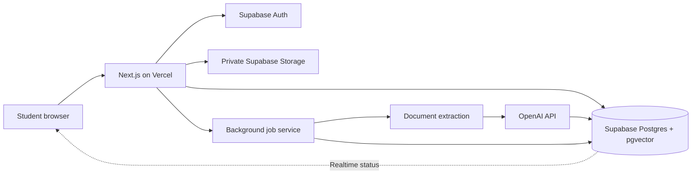

# StudyStackLM — Product and Engineering Plan

## 1. Product definition

StudyStackLM is a private, student-led group workspace that turns shared class material into source-grounded study activities.

The product loop is:

1. Create or join a group.
2. Upload a PPTX, PDF, DOCX, or text reviewer.
3. Process the source into slide- or page-level knowledge chunks.
4. Generate a reviewer, condensed slide deck, flashcards, quiz, or practice test.
5. Review and publish the generated material.
6. Study individually from the group's shared material.
7. Use results to repeat weak topics and generate focused practice.

The first release should prove one promise: a group can upload a real lesson and get a trustworthy study activity that every member can use.

## 2. Scope of the first production release

### Must ship

- Email/password and Google authentication.
- User profile with display name and avatar.
- Create, join, leave, and archive a private group.
- Join code and revocable invitation link.
- Owner, moderator, and member roles.
- Upload PPTX, PDF, DOCX, TXT, and Markdown files.
- Upload status: queued, processing, ready, failed, or needs attention.
- Source library with filename, uploader, processing status, page/slide count, and upload date.
- Generation wizard with source selection, output type, difficulty, question count, question-type mix, and language.
- Reviewer generation.
- Condensed slide deck generation and in-app presentation mode.
- Flashcard generation and study mode.
- Quiz and practice-test generation.
- Multiple choice, true/false, fill-in-the-blank, and enumeration questions.
- Draft review and editing before publication.
- Source citations on every generated section, card, and question.
- Individual attempts, scores, answer review, and personal progress.
- Group activity feed for uploads and published materials.
- Reporting and archiving inaccurate content.
- Responsive web experience and WCAG 2.2 AA fundamentals.

### Defer until the core loop works

- Live synchronized quiz rooms.
- Teacher gradebooks, assignments, deadlines, and grading.
- School and organization accounts.
- Student-to-student chat.
- Public group discovery.
- Native mobile applications.
- Real-time collaborative editing of generated materials.
- Automatically assigning official grades from AI-generated questions.

## 3. Recommended stack

| Layer | Choice | Reason |
|---|---|---|
| Web application | Next.js App Router + TypeScript | Strong Vercel integration, server components, route handlers, and one deployable codebase |
| UI | Tailwind CSS + shadcn/ui primitives | Accessible foundations with full visual control |
| Forms and validation | React Hook Form + Zod | Shared client/server validation and clear errors |
| Authentication | Supabase Auth | Email, Google OAuth, sessions, and direct connection to RLS |
| Database | Supabase PostgreSQL | Relational model, transactions, full-text search, vector support, and RLS |
| File storage | Supabase Storage | Private buckets and signed access URLs |
| Realtime | Supabase Realtime | Job progress and group activity updates |
| AI | OpenAI Responses API with structured outputs | Reliable typed generation and source-grounded outputs |
| Embeddings | OpenAI embeddings + pgvector | Semantic retrieval over uploaded source chunks |
| Background jobs | Inngest or Trigger.dev | Durable processing outside Vercel request time limits |
| Observability | Sentry + Vercel Analytics | Runtime errors, performance, and release visibility |
| Product analytics | PostHog, added after consent design | Funnel and retention measurements |
| Testing | Vitest, Testing Library, Playwright | Unit, integration, and critical end-to-end coverage |

Keep AI access behind an internal interface such as `AIProvider`. The first implementation can use OpenAI while preserving a future provider swap without spreading provider-specific code through the product.

## 4. System architecture



The browser uses the Supabase anonymous key with RLS. Privileged operations run in server-only route handlers or background jobs. The service-role key exists only in encrypted deployment secrets.

## 5. Information architecture and routes

| Route | Purpose |
|---|---|
| `/` | Product explanation and sign-in entry |
| `/login`, `/signup`, `/auth/callback` | Authentication |
| `/onboarding` | Name, study interests, and create/join choice |
| `/app` | User dashboard with groups, recent materials, and active attempts |
| `/app/groups/new` | Create a group |
| `/join/[token]` | Preview and join a group invitation |
| `/app/groups/[groupId]` | Group home and activity |
| `/app/groups/[groupId]/sources` | Source library and upload |
| `/app/groups/[groupId]/sources/[sourceId]` | Source details, processing, extracted outline, and citations |
| `/app/groups/[groupId]/generate` | Generation wizard |
| `/app/groups/[groupId]/library` | Published and draft study materials |
| `/app/materials/[materialId]/edit` | Review and edit generated material |
| `/app/materials/[materialId]/study` | Reviewer, flashcard, or slide-deck player |
| `/app/materials/[materialId]/attempt` | Quiz/practice test runner |
| `/app/attempts/[attemptId]/results` | Score, explanations, source review, and retry |
| `/app/groups/[groupId]/members` | Members, roles, invites, and moderation |
| `/app/settings` | Profile, accessibility, data, and account settings |

On desktop, use a compact left group rail and a contextual second column. On mobile, collapse navigation into a bottom bar plus page-level menus. The study player uses the full viewport and removes unrelated navigation.

## 6. Core user journeys

### Create a group

1. Student selects **Create group**.
2. Enters group name, subject, optional description, and academic term.
3. The server creates the group and owner membership in one transaction.
4. The product creates a short join code and secure invitation token.
5. The empty group shows two primary actions: **Upload first lesson** and **Invite classmates**.

### Join a group

1. Student opens an invitation or enters a join code.
2. If signed out, the return URL survives authentication.
3. The join screen shows group name, subject, owner, member count, and invitation status.
4. The server validates expiry, revocation, group capacity, and existing membership.
5. A membership is created and an activity event is recorded.

### Upload and process a lesson

1. Member selects or drops a supported file.
2. The client validates extension and size before upload.
3. The server creates a `source` record and issues a signed upload path.
4. After upload, a durable processing job starts.
5. The worker checks MIME type, extracts text, retains slide/page boundaries, detects language, and stores an outline.
6. Text is normalized, chunked, embedded, and stored with page/slide metadata.
7. The source becomes `ready`; failures expose a useful retry message.

### Generate a study material

1. Member selects ready sources.
2. Selects output: reviewer, slide deck, flashcards, quiz, or practice test.
3. Configures coverage, length, difficulty, language, and question types where relevant.
4. The server validates membership and usage quota, then creates a generation job.
5. Retrieval selects relevant source chunks.
6. AI returns schema-valid JSON with citations.
7. A verification pass rejects unsupported citations and malformed answers.
8. The result opens as an editable draft.
9. Creator publishes it to the group.

### Take a quiz

1. Student starts an attempt from the published material.
2. The server snapshots question order and choices for that attempt.
3. Answers autosave without revealing hidden answers.
4. On submit, deterministic grading handles objective types and controlled normalization handles text types.
5. Results show score, explanation, accepted answer, and source citation.
6. Weak topics feed a **Practice mistakes** action.

## 7. Data model

Use UUID primary keys, `created_at`, and `updated_at` timestamps. Use database enums only for stable values; use checked text columns for values likely to evolve.

### Identity and groups

| Table | Important fields |
|---|---|
| `profiles` | `id -> auth.users`, `display_name`, `avatar_url`, `locale` |
| `groups` | `id`, `owner_id`, `name`, `subject`, `description`, `term`, `status` |
| `group_members` | `group_id`, `user_id`, `role`, `joined_at`, unique pair |
| `group_invites` | `id`, `group_id`, `token_hash`, `short_code`, `created_by`, `expires_at`, `max_uses`, `use_count`, `revoked_at` |
| `activity_events` | `group_id`, `actor_id`, `type`, `entity_type`, `entity_id`, `metadata` |

### Sources and retrieval

| Table | Important fields |
|---|---|
| `sources` | `id`, `group_id`, `uploader_id`, `title`, `storage_path`, `mime_type`, `size_bytes`, `status`, `page_count`, `language`, `error_code` |
| `source_pages` | `id`, `source_id`, `page_number`, `heading`, `raw_text`, `thumbnail_path` |
| `source_chunks` | `id`, `source_id`, `page_id`, `chunk_index`, `content`, `token_count`, `embedding vector`, `metadata jsonb` |
| `processing_jobs` | `id`, `source_id`, `status`, `stage`, `attempt_count`, `progress`, `last_error`, `started_at`, `finished_at` |

### Generated materials

| Table | Important fields |
|---|---|
| `materials` | `id`, `group_id`, `creator_id`, `type`, `title`, `description`, `status`, `settings jsonb`, `version`, `published_at` |
| `material_sources` | `material_id`, `source_id` |
| `material_sections` | `id`, `material_id`, `position`, `kind`, `content jsonb` |
| `citations` | `id`, `material_id`, `section_id`, `question_id`, `source_chunk_id`, `quote_start`, `quote_end` |
| `flashcards` | `id`, `material_id`, `position`, `front`, `back`, `hint`, `difficulty` |
| `questions` | `id`, `material_id`, `position`, `type`, `prompt`, `explanation`, `points`, `difficulty`, `grading_config jsonb` |
| `question_options` | `id`, `question_id`, `position`, `label`, `is_correct` |
| `generation_jobs` | `id`, `group_id`, `requester_id`, `material_id`, `status`, `settings`, `provider`, `model`, `usage`, `error` |

### Attempts and mastery

| Table | Important fields |
|---|---|
| `attempts` | `id`, `material_id`, `user_id`, `status`, `started_at`, `submitted_at`, `score`, `max_score`, `duration_seconds` |
| `attempt_questions` | `attempt_id`, `question_id`, `position`, `option_order jsonb`, `points_available` |
| `answers` | `id`, `attempt_id`, `question_id`, `response jsonb`, `is_correct`, `points_awarded`, `feedback` |
| `flashcard_progress` | `user_id`, `flashcard_id`, `state`, `ease`, `interval_days`, `due_at`, `last_reviewed_at` |
| `topic_mastery` | `user_id`, `group_id`, `topic_key`, `mastery_score`, `evidence_count`, `updated_at` |

### Moderation and usage

| Table | Important fields |
|---|---|
| `content_reports` | `id`, `group_id`, `reporter_id`, `entity_type`, `entity_id`, `reason`, `details`, `status` |
| `usage_ledger` | `id`, `user_id`, `group_id`, `kind`, `units`, `provider_cost`, `metadata` |
| `audit_log` | `id`, `actor_id`, `group_id`, `action`, `target_type`, `target_id`, `metadata` |

## 8. Storage design

Create private buckets:

- `source-files`: original uploads under `groups/{group_id}/sources/{source_id}/original`.
- `source-previews`: generated slide/page thumbnails.
- `avatars`: user-controlled profile images.
- `exports`: temporary generated exports with expiry cleanup.

Do not store public URLs for lesson files. Create short-lived signed URLs after checking group membership. Validate MIME type using file content on the server, not only the browser filename.

## 9. Row Level Security

RLS is a release requirement, not a later hardening task.

Create helper SQL functions such as:

- `is_group_member(group_id, auth.uid())`
- `has_group_role(group_id, auth.uid(), roles[])`
- `owns_attempt(attempt_id, auth.uid())`

Policy rules:

- A user reads only their own profile-sensitive fields; group members see safe public profile fields.
- Group members can read their group, membership list, ready sources, and published materials.
- Owners and moderators manage membership roles and invitations.
- Members can upload if the group setting permits it; only uploader, moderator, or owner can archive a source.
- Draft materials are visible to their creator plus moderators; published materials are visible to all group members.
- Attempts, answers, flashcard progress, and mastery are visible only to their owner.
- Correct answers must not be obtainable by a quiz taker through a direct client query before submission. Serve active attempt questions through a safe view or server endpoint that omits answer keys.
- Service-role operations are restricted to background processing and audited server actions.

Write automated RLS tests for cross-group access, draft visibility, private attempts, role escalation, signed file access, and answer-key leakage.

## 10. AI and document-processing pipeline

### Extraction

- PDF: extract text per page; run OCR only for pages with insufficient text.
- PPTX: extract title, body text, speaker notes, table text, and image alt text per slide. Render thumbnails separately.
- DOCX: preserve headings, paragraphs, lists, and tables.
- TXT/Markdown: preserve headings and sections.
- Reject password-protected or corrupt files with a specific recovery message.

### Chunking and indexing

- Preserve page/slide boundaries.
- Split large pages by semantic heading and token limit with small overlap.
- Store the source location and checksum on every chunk.
- Generate embeddings after extraction.
- Deduplicate chunks by normalized content hash.
- Use hybrid retrieval: vector similarity plus PostgreSQL full-text rank.

### Generation stages

1. Validate request, group membership, source readiness, and quota.
2. Build a topic outline from selected sources.
3. Retrieve coverage-balanced chunks instead of only top-similarity chunks.
4. Ask the model for strict JSON matching a Zod/JSON Schema contract.
5. Require source chunk IDs for each factual item.
6. Reject citations that were not included in the model context.
7. Run deterministic validation: counts, unique IDs, option rules, answer presence, citation existence, and unsafe output.
8. Store a versioned draft and usage record.
9. Let the creator edit before publishing.

### Generation contracts

- Reviewer: sections with title, explanation, key points, examples, and citations.
- Slide deck: slides with title, concise body, optional speaker note, and citations. Limit text density.
- Flashcards: front, back, hint, difficulty, topic, and citations. Avoid duplicate cards.
- Quiz: question, type, options when applicable, canonical answer, accepted alternatives, explanation, difficulty, and citations.
- Practice test: the quiz contract plus section timing, point totals, and a balanced blueprint.

Never ask the model to grade multiple-choice or true/false answers. Grade these deterministically from stored keys.

## 11. Question behavior and grading

| Type | Authoring rules | Grading rules |
|---|---|---|
| Multiple choice | 3–5 plausible options, one correct answer by default, no clueing language | Exact option ID match |
| True/false | One unambiguous claim; explanation must correct a false statement | Exact boolean match |
| Fill in the blank | One meaningful blank; store canonical answer and accepted variants | Normalize case, whitespace, punctuation, and approved variants; do not use unrestricted semantic grading for official score |
| Enumeration | State required item count and whether order matters; store acceptable item set and aliases | Match normalized items, remove duplicates, award configured partial credit |

For fill-in and enumeration, show **Needs review** when an answer is close but outside accepted variants. A later AI-assisted review may suggest a score, but the deterministic result remains visible and auditable.

## 12. UX and visual direction

StudyStackLM should feel like a focused shared study desk. The application surface is an **Operate** experience: students should always understand what is available, what is processing, and what they can do next.

Use a calm ink-and-paper palette with one vivid learning accent. Avoid a generic grid of equal cards. Let the group workspace behave like a stack of materials: sources on the left, the selected learning object in the main area, and citations or activity in a contextual side panel.

Key interface rules:

- The dashboard prioritizes **Continue studying**, then groups and recent materials.
- A group home leads with the current material and processing activity, not vanity statistics.
- Upload progress names the current stage: uploading, extracting, indexing, generating preview, or ready.
- The generation wizard uses a short sequence with a live summary of the requested output.
- Generated drafts visibly say **AI-generated draft** and provide edit, regenerate section, cite, publish, and discard actions.
- Citation chips open the exact source slide/page in a side panel.
- Quiz mode uses one question per view, persistent progress, autosave, keyboard shortcuts, and a clear submit boundary.
- Flashcard mode supports tap/space to reveal and Again/Hard/Good/Easy responses without requiring a pointer.
- Mobile study mode keeps controls within thumb reach and removes the group navigation.
- Empty states contain one primary action and a short example of what happens next.
- Motion communicates state change; respect `prefers-reduced-motion`.

## 13. API and server boundaries

Prefer typed server actions for first-party form mutations and route handlers for uploads, webhooks, background jobs, and stable API boundaries.

Representative endpoints:

- `POST /api/groups` — create group and owner membership transaction.
- `POST /api/groups/:id/invites` — create or rotate invitation.
- `POST /api/invites/:token/join` — validate and join.
- `POST /api/sources/init-upload` — create source and signed upload target.
- `POST /api/sources/:id/complete-upload` — verify object and enqueue processing.
- `POST /api/materials/generate` — validate request and enqueue generation.
- `GET /api/jobs/:id` — fallback job status; Realtime is the primary live channel.
- `PATCH /api/materials/:id` — edit a draft with optimistic concurrency.
- `POST /api/materials/:id/publish` — validate completeness and publish.
- `POST /api/materials/:id/attempts` — create immutable attempt snapshot.
- `PATCH /api/attempts/:id/answers/:questionId` — autosave response.
- `POST /api/attempts/:id/submit` — transactionally grade and finalize.
- `POST /api/reports` — report generated content.

Every mutation validates the session, input schema, membership, role, entity state, and idempotency key where retries are possible.

## 14. Repository structure

```text
app/
  (marketing)/
  (auth)/
  app/
  api/
components/
  ui/
  groups/
  sources/
  materials/
  study/
lib/
  auth/
  db/
  supabase/
  ai/
  extraction/
  grading/
  permissions/
  validation/
jobs/
  process-source.ts
  generate-material.ts
  cleanup-exports.ts
supabase/
  migrations/
  seed.sql
  tests/
tests/
  unit/
  integration/
  e2e/
```

Feature code should depend on domain functions such as `createGroup`, `publishMaterial`, and `submitAttempt`, rather than directly scattering Supabase queries across components.

## 15. Build sequence

### Phase 0 — Foundation

- Create Next.js TypeScript project with linting and formatting.
- Create Supabase local project and migrations.
- Configure environment validation and generated database types.
- Add CI for type checking, linting, unit tests, migration checks, and production build.
- Establish error tracking and structured logs.

Exit criteria: preview deployment builds; local Supabase reset and seed work from a clean checkout.

### Phase 1 — Authentication and groups

- Implement authentication and onboarding.
- Create profiles, groups, memberships, and invitations.
- Add group creation, join, leave, role management, and archive flows.
- Add RLS and cross-account tests.

Exit criteria: two test users can create and join one private group; neither can access a different group's data.

### Phase 2 — Source library

- Create private storage buckets and signed upload flow.
- Implement source list, detail, status, archive, and retry.
- Add durable processing job and extraction adapters.
- Store pages, chunks, thumbnails, and embeddings.

Exit criteria: supported files become searchable, page-addressable sources; malformed files fail safely.

### Phase 3 — Generation and editor

- Implement generation wizard and job progress.
- Add retrieval, structured generation, validation, and citations.
- Build editors for reviewer, slides, flashcards, and questions.
- Add publish/version workflow and reports.

Exit criteria: a real lesson produces editable, cited material with no dangling citations or invalid question structures.

### Phase 4 — Study modes

- Build reviewer reader and slide player.
- Build accessible flashcard study flow and progress.
- Build quiz runner, autosave, submit, grading, and results.
- Add retry mistakes and attempt history.

Exit criteria: each question type grades correctly; another group member can study the published material while attempts remain private.

### Phase 5 — Production hardening

- Add quotas, rate limits, file validation, retry policies, and idempotency.
- Add accessibility, responsive, performance, and empty/error-state passes.
- Add data export and account deletion workflows.
- Add monitoring dashboards and support diagnostics.
- Run security review on RLS, storage, answer keys, service-role use, and prompt injection boundaries.

Exit criteria: the release checklist passes in preview and production environments.

## 16. Testing strategy

Test behavior with the highest cost of failure.

- Unit: answer normalization, enumeration partial credit, invite expiry, generation-schema validators, permissions.
- Database: every RLS policy with two users in different groups; migrations from clean state.
- Integration: upload completion, job idempotency, citation validation, publish transaction, attempt submission.
- End-to-end: sign up; create group; join from a second account; upload; generate; edit; publish; take each quiz type; review results.
- Security: cross-group ID probing, draft access, answer-key exposure, signed URL expiry, role escalation, malicious filenames, oversized files, and prompt injection in source text.
- Accessibility: keyboard-only study flows, screen-reader labels, focus order, contrast, zoom to 200%, and reduced motion.
- Performance: dashboard and group pages within Core Web Vitals targets; large sources process asynchronously without blocking navigation.

Do not call AI in ordinary test runs. Store representative provider fixtures and run a small opt-in contract suite against the real provider before release.

## 17. Security and privacy checklist

- Keep all buckets private by default.
- Hash invitation tokens in the database; display raw tokens only when created.
- Apply rate limits to authentication, joining, uploads, generation, and submission.
- Validate actual MIME signatures and sanitize filenames.
- Scan uploads for malware before processing in a mature production rollout.
- Escape extracted and generated content before rendering; sanitize any supported rich text.
- Treat lesson content as data, never as instructions to the AI system.
- Send the minimum retrieved lesson text to the AI provider.
- Record model, prompt version, token usage, source IDs, and generation status without logging secret or unnecessary personal content.
- Define retention for originals, exports, deleted groups, and provider logs.
- Provide group deletion, account deletion, and personal-data export.
- Publish clear terms explaining upload rights and AI limitations before public launch.

## 18. Vercel and Supabase deployment

### Supabase

1. Create production and staging projects.
2. Enable email authentication and Google OAuth.
3. Set allowed redirect URLs for local, Vercel preview, staging, and production.
4. Apply versioned migrations using the Supabase CLI.
5. Create private storage buckets and policies.
6. Enable pgvector and required PostgreSQL extensions.
7. Configure Realtime only for the tables and events needed by the UI.
8. Back up the production database and test restore procedures.

### Vercel

1. Import the Git repository.
2. Set the framework preset to Next.js.
3. Configure environment variables separately for preview and production.
4. Connect the production domain and update Supabase redirect URLs.
5. Configure background-job signing secrets and webhooks.
6. Deploy migrations before application code that depends on them.
7. Run smoke tests against the final production URL.

Required environment variables should include:

```text
NEXT_PUBLIC_APP_URL
NEXT_PUBLIC_SUPABASE_URL
NEXT_PUBLIC_SUPABASE_ANON_KEY
SUPABASE_SERVICE_ROLE_KEY
OPENAI_API_KEY
OPENAI_GENERATION_MODEL
OPENAI_EMBEDDING_MODEL
BACKGROUND_JOB_SIGNING_KEY
SENTRY_DSN
```

Validate environment variables at startup. Never prefix server secrets with `NEXT_PUBLIC_`.

## 19. Release acceptance criteria

The first release is ready when all of the following are true:

- A new user can authenticate, create a group, and invite a second user.
- The second user can join without accessing any other private group.
- A supported lesson uploads and reaches `ready` through a durable job.
- Every extracted page or slide can be opened from a citation.
- Each material type can be generated, edited, saved as a draft, and published.
- Every published question has a valid answer, explanation, and at least one valid source citation.
- All four question types can be completed and graded according to their documented rules.
- Attempts autosave, submit once, and remain private to the student.
- Owners can revoke invitations, change roles, archive content, and handle reports.
- Failed processing and generation jobs can be safely retried without duplicate records.
- RLS and storage policy tests pass.
- Critical flows pass on current Chrome, Edge, Safari, Firefox, and a 390 px mobile viewport.
- Keyboard and screen-reader checks pass for upload, generation, flashcards, and quizzes.
- Production monitoring records errors without exposing uploaded lesson content or secrets.

## 20. Product metrics

Track metrics that test the core promise:

- Percentage of new groups that upload a source.
- Median time from upload start to first ready study material.
- Generation success and publish rates by material type.
- Percentage of published materials used by another group member.
- Quiz completion and retry rates.
- Citation-open rate and content-report rate.
- Seven-day group return rate.
- AI cost per processed source and per completed study session.

Avoid public leaderboards or engagement mechanics that reward speed over learning in the first release.

## 21. Risks and controls

| Risk | Control |
|---|---|
| AI invents facts | Retrieve only selected source chunks, require citations, validate citation IDs, and require review before publish |
| Poor scans produce poor questions | Surface extraction quality, support OCR, show source preview, and allow exclusion of bad pages |
| Answer key leaks | Separate safe attempt payloads from authoring data; verify with RLS and endpoint tests |
| Large files exceed request limits | Upload directly to Storage and process asynchronously |
| Vercel function timeout | Use durable external background jobs for extraction and generation |
| A member deletes shared work | Archive instead of hard delete and restrict destructive actions by role |
| Cost spikes | Per-user/group quotas, token budgets, deduplication, caching, and usage ledger |
| Copyright/privacy concerns | Private groups, clear uploader responsibility, deletion controls, limited provider retention, and minimum necessary AI context |
| Low trust in generated content | Exact source links, visible draft status, editable output, explanations, and reporting |

## 22. Recommended launch order

Build and release in a closed alpha with 3–5 real study groups. Give them one complete path—PDF/PPTX to flashcards and mixed quiz—before expanding every generator. Observe failed uploads, edits made before publishing, disputed grading, and where citations are opened. Use that evidence to refine extraction and generation contracts, then open the remaining reviewer and slide-deck modes to a larger beta.

The plan describes the complete first release. The smartest implementation order still concentrates early testing on the hardest product truth: whether real lesson files can reliably become cited questions students trust.
